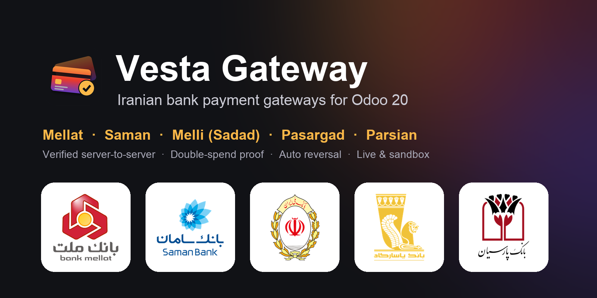
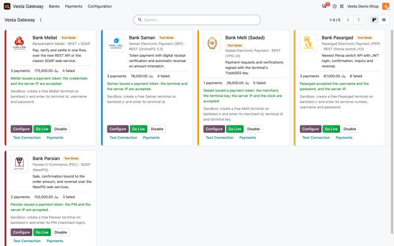
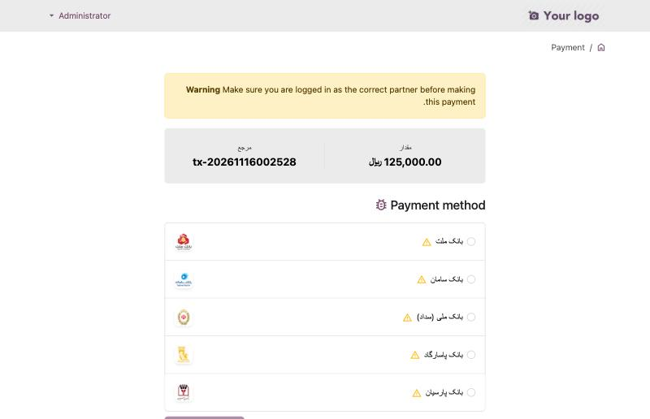
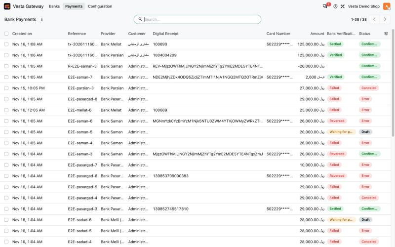
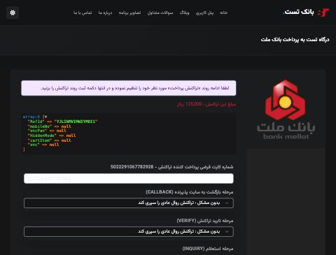
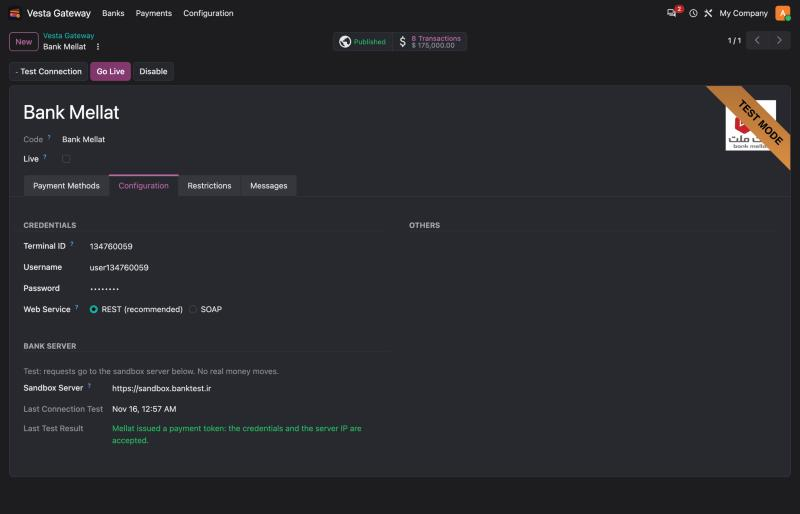
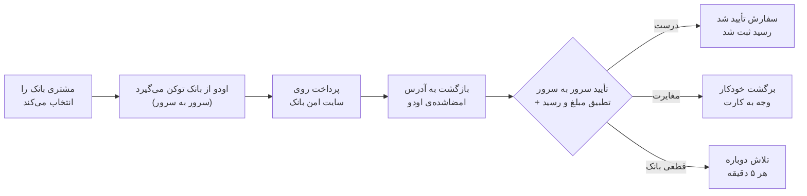

<p align="center">
  
</p>

<p align="center">
  
  
  
  
</p>

<p align="center">
  <a href="#fa">فارسی</a> · <a href="#en">English</a> ·
  <a href="docs/ACTIVATION.md">راهنمای فعال‌سازی</a> ·
  <a href="docs/SECURITY.md">امنیت</a> ·
  <a href="docs/INTEGRATION.md">نحوه‌ی اتصال</a>
</p>

---

<div dir="rtl" id="fa">

## درگاه وستا؛ پرداخت بانک‌های ایرانی در اودو ۲۰

**درگاه وستا** کامل‌ترین ماژول بومی‌سازی پرداخت اینترنتی برای اودو ۲۰ است: درگاه بانک‌های **ملت، سامان، ملی (سداد)، پاسارگاد و پارسیان** با یک هسته‌ی مشترک امن، یک داشبورد برای نصب، آزمایش، روشن و خاموش کردن و پایش همه‌ی بانک‌ها، و حالت آزمایشی آماده روی سندباکس banktest.ir.

مشتری در فروشگاه اینترنتی، پورتال، لینک پرداخت فاکتور یا سفارش فروش، بانک دلخواهش را انتخاب می‌کند، در صفحه‌ی امن بانک پرداخت می‌کند و برمی‌گردد. درگاه وستا پرداخت را **سرور به سرور با بانک تأیید می‌کند**، مبلغ را با سفارش تطبیق می‌دهد، رسید بانک را فقط به یک سفارش وصل می‌کند و اگر چیزی درست نبود، **پول را خودکار به کارت مشتری برمی‌گرداند**.

> ⭐ اگر به کارتان آمد، به این مخزن ستاره بدهید تا بقیه هم پیدایش کنند.

### این مخزن و نسخه‌ی حرفه‌ای

| ماژول | بانک | سرویس | این مخزن (متن‌باز) | درگاه وستا حرفه‌ای (زیپ) |
|---|---|---|:---:|:---:|
| `vesta_payment` | اپ «درگاه وستا» و هسته‌ی مشترک | — | ✅ | ✅ |
| `vesta_payment_mellat` | **بانک ملت** (به‌پرداخت) | REST + SOAP | ✅ | ✅ |
| `vesta_payment_saman` | **بانک سامان** (سپ) | REST · OnlinePG 3.3 | | ✅ |
| `vesta_payment_sadad` | **بانک ملی** (سداد) | REST · VPG v0 | | ✅ |
| `vesta_payment_pasargad` | **بانک پاسارگاد** (پپ، سوییچ پرسا) | REST · نسخه ۱۳ | | ✅ |
| `vesta_payment_parsian` | **بانک پارسیان** (پک) | SOAP · NewIPG | | ✅ |

### امکانات

**پرداخت**
- 🏦 پنج بانک اصلی شاپرک، هر کدام با جدیدترین سرویس رسمی‌اش؛ ملت با **REST یا SOAP** به انتخاب شما
- 🔁 جریان کامل هر بانک: درخواست توکن ← پرداخت ← بازگشت ← تأیید ← تسویه/تأیید نهایی ← برگشت
- 💸 **استرداد از داخل اودو** برای سامان، پاسارگاد و پارسیان (دکمه‌ی Refund)
- 📱 ارسال موبایل مشتری به بانک برای نمایش کارت‌های ذخیره‌شده
- 💱 ریال (`IRR`) و تومان (`IRT`) با تبدیل خودکار به ریال
- 🛒 کار در فروشگاه اینترنتی، پورتال مشتری، لینک پرداخت فاکتور و سفارش فروش؛ وابستگی فقط به `payment`

**امنیت** ([جزئیات](docs/SECURITY.md))
- ✅ تأیید **سرور به سرور** هر پرداخت؛ فرم بازگشت هیچ‌وقت به‌تنهایی پذیرفته نمی‌شود
- 🔐 آدرس بازگشت امضاشده با **HMAC**، تطبیق زمان‌ثابت توکن بانک
- 🧾 جلوگیری از **دوبار مصرف رسید** با ایندکس یکتای پایگاه‌داده
- ⚖️ تطبیق مبلغ و **برگشت خودکار وجه** در مغایرت؛ برگشت خودکار وقتی تسویه/تأیید نهایی ناموفق است
- 🔒 قفل تراکنش در برابر بازگشت هم‌زمان و دوبار کلیک
- ♻️ **تلاش دوباره‌ی خودکار** تأیید در قطعی بانک، تا پایان مهلت هر بانک
- 🛡️ پارسر SOAP ایمن در برابر XXE، پنهان شدن رمزها در لاگ، پاک شدن رمزها در کپی تستی پایگاه‌داده

**مدیریت**
- 🎛️ **داشبورد درگاه وستا**: کارت هر بانک با وضعیت (عملیاتی، آزمایشی، غیرفعال)، آمار ۳۰ روز، هشدار تنظیمات ناقص
- 🔌 دکمه‌ی **آزمایش اتصال** بدون جابه‌جایی پول: رمز، IP سرور و دسترسی بانک را بررسی می‌کند
- 🟢 **فعال‌سازی عملیاتی / حالت آزمایشی / غیرفعال** با یک کلیک، با سرور آزمایشی قابل تغییر
- 📋 گزارش **پرداخت‌های بانکی** با رسید دیجیتال، RRN، شماره پیگیری، کارت پوشیده و وضعیت تأیید بانک
- 🇮🇷 ترجمه‌ی کامل فارسی، پیام خطای فارسی هر کد بانک

### تصویرها

<p align="center"></p>

| انتخاب بانک در صفحه‌ی پرداخت | پرداخت‌های بانکی |
|---|---|
|  |  |
| **صفحه‌ی پرداخت آزمایشی ملت** | **پیکربندی بانک** |
|  |  |

### چطور کار می‌کند



### شروع سریع

```bash
cd /opt/odoo/custom-addons
git clone -b 20.0 https://github.com/vestaai-ir/vesta-payment-iran.git
```

1. مسیر `vesta-payment-iran` را به `addons_path` اضافه کنید و اودو را راه‌اندازی مجدد کنید.
2. **برنامه‌ها ← به‌روزرسانی فهرست** و نصب **Vesta Gateway**.
3. **درگاه وستا ← بانک‌ها ← نصب** روی بانک ملت.
4. **پیکربندی**: شناسه ترمینال، نام کاربری و رمز را وارد کنید ← **حالت آزمایشی** ← **آزمایش اتصال**.
5. بعد از خرید آزمایشی موفق، اطلاعات اصلی را وارد کنید و **فعال‌سازی عملیاتی** را بزنید.

راهنمای کامل همه‌ی بانک‌ها، روی سرور اصلی و آزمایشی، با جدول رفع اشکال: **[docs/ACTIVATION.md](docs/ACTIVATION.md)**

### مستندات

| سند | محتوا |
|---|---|
| [ACTIVATION.md](docs/ACTIVATION.md) | نصب، حالت آزمایشی، فعال‌سازی عملیاتی، روشن/خاموش کردن، کار روزانه، رفع اشکال |
| [SECURITY.md](docs/SECURITY.md) | مدل تهدید با ۲۰ مورد، کنترل‌ها و محل آن‌ها در کد، نکته‌های هر بانک، چک‌لیست راه‌اندازی امن |
| [INTEGRATION.md](docs/INTEGRATION.md) | آدرس سرویس‌ها، پارامترها، ترتیب فراخوانی و کدهای پاسخ هر بانک، نکته‌های کشف‌شده در سندباکس |

### آزمایش‌شده

- **۵۰ تست خودکار** (بدون نیاز به اینترنت): تأیید، تسویه، برگشت، دوبار مصرف رسید، مغایرت مبلغ، توکن جعلی، امضای آدرس، تلاش دوباره، XXE، تبدیل تومان
  ```bash
  odoo -d test_db -i vesta_payment_mellat --test-tags=/vesta_payment,/vesta_payment_mellat --stop-after-init
  ```
- **آزمون سرتاسری روی سندباکس banktest.ir** برای هر پنج بانک: پرداخت موفق، انصراف مشتری، خطای تأیید، خطای تسویه با برگشت خودکار، تایم‌اوت ۶۵ ثانیه‌ای و تلاش دوباره، دوبار مصرف رسید، مغایرت مبلغ و استرداد.

### سازگاری

اودو ۲۰ (Community و Enterprise)، پایتون ۳.۱۲ به بالا. بدون وابستگی خارجی: `requests`، `lxml` و `cryptography` همراه اودو نصب می‌شوند.

### مجوز

هسته و بانک ملت: [LGPL-3](LICENSE). درگاه وستا حرفه‌ای (سامان، ملی، پاسارگاد، پارسیان) جداگانه به صورت فایل زیپ ارائه می‌شود.
ساخته‌ی [هوش مصنوعی وستا](https://vestaai.ir). نشان‌های بانک‌ها متعلق به خود بانک‌هاست و فقط برای معرفی درگاه آن‌ها استفاده شده است.

</div>

---

<div id="en">

## Vesta Gateway: Iranian bank payments for Odoo 20

**Vesta Gateway** brings the payment gateways of **Bank Mellat, Bank Saman, Bank Melli (Sadad), Bank Pasargad and Bank Parsian** to Odoo 20, on one secure core, with one dashboard to install, test, enable, disable and monitor every bank, and a ready-made test mode on the banktest.ir sandbox.

Customers pick their bank on the website, customer portal, invoice payment link or sales order, pay on the bank's secure page and come back. Vesta Gateway **confirms each payment server-to-server**, checks the amount against the order, binds each bank receipt to a single order and **reverses the money automatically** when anything is off.

### This repository and Pro

This repository holds the core app (`vesta_payment`) and **Bank Mellat** (`vesta_payment_mellat`, REST and SOAP). Saman, Melli (Sadad), Pasargad and Parsian are part of **Vesta Gateway Pro**, shipped as a zip; the dashboard lists them with a "Get Pro" button until their modules are in the addons path.

### Highlights

- Server-to-server verification of every payment; the browser's return form is never trusted alone
- HMAC-signed return URLs, constant-time token checks, transaction locking against double processing
- Double-spending protection: a database unique index binds each bank receipt to one transaction
- Amount check with automatic reversal; reversal when settlement/confirmation fails (Mellat, Pasargad)
- Automatic retries of the bank confirmation by cron until each bank's window closes
- Refunds from Odoo for Saman, Pasargad and Parsian
- Rial (IRR) and Toman (IRT); bank-time (Asia/Tehran) handling; TripleDES signing for Sadad; JWT caching for Pasargad
- XXE-safe SOAP, credentials masked in logs, restricted to Settings users, wiped on database neutralization
- Dashboard with live/test/disabled toggles, connection test, 30-day statistics; full Persian translation
- 50 automated tests and end-to-end runs of every bank on the sandbox

### Documentation

[Activation guide](docs/ACTIVATION.md) · [Security](docs/SECURITY.md) · [Integration details](docs/INTEGRATION.md) (Persian).

### License

Core and Bank Mellat: [LGPL-3](LICENSE). Made by [Vesta AI](https://vestaai.ir). Bank logos belong to their banks and are only used to identify their gateways.

</div>
