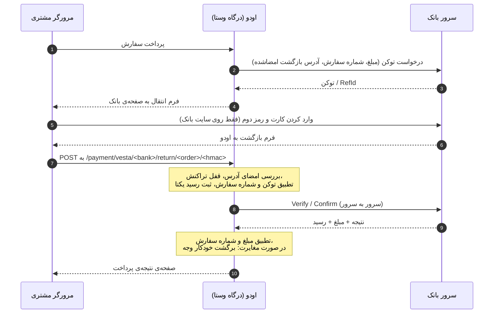

# امنیت درگاه وستا

این سند توضیح می‌دهد درگاه وستا چه تهدیدهایی را در پرداخت اینترنتی بانک‌های ایرانی پوشش می‌دهد، هر کنترل امنیتی کجای کد است، و پذیرنده پیش از رفتن روی سرور اصلی بانک چه کارهایی باید انجام دهد.
همه‌ی بانک‌ها (ملت، سامان، ملی/سداد، پاسارگاد و پارسیان) یک هسته‌ی مشترک دارند (`vesta_payment`)؛ پس هر کنترل این سند برای همه‌ی بانک‌ها برقرار است، مگر جایی که جدا گفته شده.

> نسخه: ۲۰.۰.۱.۰.۰ · آخرین بازبینی: آبان ۱۴۰۵ (نوامبر ۲۰۲۶) · گزارش آسیب‌پذیری: پایین همین سند

---

## ۱. اصل اول: به داده‌ی برگشتی از مرورگر اعتماد نکن

مشتری بعد از پرداخت با یک فرم از سایت بانک به سایت شما برمی‌گردد. این فرم **از مرورگر مشتری** فرستاده می‌شود، نه از سرور بانک؛ یعنی هر کسی می‌تواند آن را جعل کند، تغییر دهد یا دوباره بفرستد.
برای همین درگاه وستا با داده‌ی برگشتی فقط «تراکنش را پیدا می‌کند» و نتیجه‌ی پرداخت را **همیشه از سرور بانک می‌پرسد** (Verify / Confirm). سفارش فقط وقتی تأیید می‌شود که سرور بانک، با اطلاعاتی که خود اودو نگه داشته، پرداخت را تأیید کند و مبلغ تأییدشده با مبلغ سفارش یکی باشد.

---

## ۲. مدل تهدید و کنترل‌ها

| # | تهدید | کنترل در درگاه وستا | محل در کد |
|---|---|---|---|
| T1 | **جعل فرم بازگشت** (مثلاً `State=OK` یا `ResCode=0` ساختگی) | نتیجه‌ی فرم هیچ‌وقت مستقیم استفاده نمی‌شود؛ پرداخت با فراخوانی سرور به سرور Verify/Confirm تأیید می‌شود. | `_vesta_verify` در هر بانک |
| T2 | **حدس یا دست‌کاری آدرس بازگشت** برای تراکنش دیگران | آدرس بازگشت شامل HMAC-SHA256 کد بانک و شماره سفارش با کلید مخفی پایگاه‌داده (`database.secret`) است و با مقایسه‌ی زمان‌ثابت بررسی می‌شود. | `_vesta_return_url`، `_vesta_find_from_return` |
| T3 | **ارسال توکن یک تراکنش برای تراکنش دیگر** | توکن/RefId بازگشتی باید دقیقاً همان توکنی باشد که بانک برای همین تراکنش صادر کرده (`consteq`). شماره سفارش و (در سامان) شماره ترمینال هم باید یکی باشد؛ وگرنه داده نادیده گرفته می‌شود. | `_vesta_check_token`، `_vesta_parse_callback` |
| T4 | **دوبار مصرف رسید دیجیتال (Double Spending)** — بانک‌ها یک رسید را هر چند بار که بخواهید دوباره «تأیید» می‌کنند | هر رسید (RefNum، SaleReferenceId، RRN، referenceNumber) فقط به یک تراکنش وصل می‌شود: بررسی در کد + **ایندکس یکتای پایگاه‌داده** روی `(provider_id, vesta_bank_reference)` که در برابر درخواست‌های هم‌زمان هم می‌ایستد. | `_vesta_claim_receipt`، `_vesta_bank_reference_uniq` |
| T5 | **پرداخت مبلغ کمتر** (مثلاً رسید یک پرداخت ۲۰ هزار ریالی برای سفارش ۲۶ هزار ریالی) | مبلغ برگشتی از Verify با مبلغ تراکنش مقایسه می‌شود؛ در مغایرت، **وجه خودکار به کارت مشتری برگشت داده می‌شود** و سفارش تأیید نمی‌شود. اودو هم بعد از آن مبلغ را دوباره بررسی می‌کند (`_validate_amount`). | `_vesta_amount_matches`، `_vesta_reject_amount` |
| T6 | **دست‌کاری مبلغ پیش از پرداخت** | مبلغ فقط در درخواست سرور به سرور توکن فرستاده می‌شود و در فرم مرورگر نیست. ملت و پارسیان مبلغ را به توکن گره می‌زنند؛ پارسیان با `ConfirmPaymentWithAmount` مبلغ و سفارش را دوباره بررسی می‌کند. | `_vesta_request_payment` |
| T7 | **تأیید دوباره‌ی یک پرداخت** (دوبار کلیک، بازگشت هم‌زمان، تکرار درخواست) | تراکنش با `SELECT … FOR UPDATE NOWAIT` قفل می‌شود؛ تراکنشی که دیگر منتظر بانک نیست یا داده‌ی در صف پردازش دارد نادیده گرفته می‌شود. | `_vesta_handle_return` |
| T8 | **قطع ارتباط با بانک وسط تأیید** (پول کم شده ولی جواب نیامده) | تراکنش «در انتظار تأیید» می‌ماند و کران هر ۵ دقیقه تا پایان مهلت بانک دوباره تلاش می‌کند. پاسخ‌های «قبلاً تأیید شده» (ملت ۴۳، سداد ۱۰۰، پاسارگاد ۱۳۰۲۹، پارسیان ۱۵۳۳-) درست تفسیر می‌شوند. بعد از مهلت، تراکنش ناموفق می‌شود و بانک خودش وجه را برمی‌گرداند. | `_vesta_verify_and_record`، `_cron_vesta_reconcile` |
| T9 | **تأیید بدون تسویه** (ملت: Verify موفق ولی Settle نه؛ پاسارگاد: Verify موفق ولی Confirm نه) | بلافاصله درخواست برگشت (Reversal) فرستاده می‌شود تا مشتری پولی برای سفارش تأییدنشده ندهد. | ملت `_vesta_verify`، پاسارگاد `_vesta_verify` |
| T10 | **CSRF و تثبیت نشست** روی مسیر بازگشت | مسیر بازگشت `csrf=False` است (چون بانک فرم را می‌فرستد) ولی هیچ عملی بدون امضای HMAC و توکن بانک انجام نمی‌دهد. با `save_session=False` نشست مشتری عوض نمی‌شود؛ صفحه‌ی بازگشت با یک ناوبری هم‌مبدأ مشتری را به `/payment/status` می‌برد تا کوکی `SameSite=Lax` دوباره فرستاده شود. | `controllers/main.py` |
| T11 | **تغییر مسیر به سایت جعلی** (Open Redirect) | آدرس صفحه‌ی پرداختی که پاسارگاد برمی‌گرداند فقط اگر HTTPS و روی دامنه‌ی بانک (یا سرور آزمایشی) باشد پذیرفته می‌شود. آدرس‌های بقیه‌ی بانک‌ها ثابت و داخل کد است. | `_vesta_is_bank_url` |
| T12 | **XXE و تزریق XML** در پاسخ یا درخواست SOAP | پارسر XML موجودیت خارجی را باز نمی‌کند و به شبکه نمی‌رود (`resolve_entities=False, no_network=True`). درخواست‌ها با lxml ساخته می‌شوند و مقدارها escape می‌شوند، نه چسباندن رشته. | `utils.build_soap_envelope`، `utils.parse_soap_response` |
| T13 | **نشت رمز در لاگ** | کلیدهای `userPassword`، `password`، `LoginAccount`، `SignData`، `Authorization` و تگ‌های XML رمز در لاگ با `[REDACTED]` جایگزین می‌شوند؛ توکن JWT پاسارگاد هم لاگ نمی‌شود. | `const.SENSITIVE_KEYS`، `_log_request`، `_log_response` |
| T14 | **دسترسی کاربر غیرمجاز به رمزها** | فیلدهای رمز (`mellat_password`، `sadad_terminal_key`، `pasargad_password`، `parsian_pin`) و توکن و هش کارت فقط برای گروه «تنظیمات» (`base.group_system`) خواندنی‌اند و در فرم به شکل رمز نمایش داده می‌شوند. | `groups="base.group_system"` |
| T15 | **کپی پایگاه‌داده‌ی اصلی روی سرور تست** که با رمزهای واقعی پول بگیرد | با «Neutralize» اودو، رمزهای همه‌ی بانک‌ها پاک و حالت عملیاتی خاموش می‌شود. | `data/neutralize.sql` هر بانک |
| T16 | **تکرار شماره سفارش** بین چند پایگاه‌داده با یک ترمینال (مثلاً تست و اصلی) | شماره سفارش ۱۸ رقمی از زمان (میلی‌ثانیه) + شناسه‌ی تراکنش + عدد تصادفی امن (`secrets`) ساخته می‌شود. | `_vesta_generate_order_id` |
| T17 | **ذخیره‌ی اطلاعات کارت** | اودو هرگز شماره کامل کارت، رمز دوم یا CVV2 نمی‌بیند؛ همه روی سایت بانک وارد می‌شود. فقط شماره‌ی پوشیده (`502229******2928`) و هش کارت که خود بانک می‌دهد ذخیره می‌شود. | `utils.mask_card` |
| T18 | **ارتباط ناامن یا سرور جعلی** | همه‌ی فراخوانی‌ها HTTPS با بررسی گواهی (`requests` با `verify` پیش‌فرض) و مهلت ۱۰ ثانیه‌اند. سرور آزمایشی هم باید HTTPS باشد. | `_send_api_request` اودو، `_check_vesta_sandbox_url` |
| T19 | **اختلاف ساعت سرور** (سداد زمان محلی را امضا و بررسی می‌کند) | زمان همیشه به وقت تهران (`Asia/Tehran`) و مستقل از منطقه‌ی زمانی سرور ساخته می‌شود. خطای ۱۰۱۸ سداد یعنی ساعت سرور باید با NTP هماهنگ شود. | `utils.bank_now` |
| T20 | **پرداخت‌های رهاشده** (مشتری از صفحه‌ی بانک برنگشته) | بعد از ۲ ساعت لغو می‌شوند. بانک پرداخت تأییدنشده را خودش برمی‌گرداند؛ پس پولی بلاتکلیف نمی‌ماند. | `_cron_vesta_reconcile` |

---

## ۳. نکته‌های امنیتی هر بانک

### بانک ملت (به‌پرداخت)
- **احراز هویت:** نام کاربری و رمز عبور ترمینال. سرویس REST هم در Basic Auth و هم در بدنه‌ی درخواست آن‌ها را می‌خواند؛ درگاه وستا هر دو را می‌فرستد (روی HTTPS).
- **اتصال مبلغ:** مبلغ در `bpPayRequest` به RefId گره می‌خورد و `bpVerifyRequest` شماره سفارش را با شماره مرجع خرید (`SaleReferenceId`) تطبیق می‌دهد؛ پس مبلغ تأییدشده همان مبلغ درخواست‌شده است.
- **ترتیب:** Verify ← Settle. اگر Settle ناموفق باشد، `bpReversalRequest` فرستاده می‌شود.
- **IP و دامنه:** درخواست فقط از IP ثبت‌شده پذیرفته می‌شود (خطای ۴۲۱) و آدرس بازگشت باید در دامنه‌ی ثبت‌شده‌ی پذیرنده باشد (خطای ۶۲).

### بانک سامان (سپ)
- **احراز هویت:** فقط IP سرور؛ رمز ندارد. پس **ثبت IP درست مهم‌ترین کنترل** است (خطاهای ۸، ۱۸-، ۱۰۶-).
- **دوبار مصرف رسید:** سامان رسید را بارها تأیید می‌کند و در پاسخ Verify شماره سفارش (ResNum) را برنمی‌گرداند. درگاه وستا رسید را پیش از Verify به تراکنش قفل می‌کند و شماره ترمینال و مبلغ پاسخ را بررسی می‌کند.
- **مهلت‌ها:** Verify تا ۳۰ دقیقه، Reverse تا ۵۰ دقیقه بعد از تراکنش.
- **مغایرت مبلغ:** طبق مستند سامان، کل مبلغ باید برگردد؛ درگاه وستا خودکار `ReverseTransaction` می‌فرستد.

### بانک ملی (سداد)
- **احراز هویت:** امضای TripleDES (ECB، PKCS7، Base64) با کلید ترمینال: `SignData = 3DES("TerminalId;OrderId;Amount")` در درخواست و `3DES(Token)` در Verify. کلید هرگز فرستاده نمی‌شود.
- **بررسی‌ها:** Verify شماره سفارش و مبلغ را برمی‌گرداند و هر دو بررسی می‌شوند. RetrivalRefNo رسید یکتای پرداخت است.
- **ساعت:** `LocalDateTime` به وقت تهران امضا و بررسی می‌شود.

### بانک پاسارگاد (پپ، سوییچ پرسا)
- **احراز هویت:** ورود با نام کاربری و رمز و دریافت JWT. توکن تا یک دقیقه پیش از انقضا در حافظه نگه داشته می‌شود و در صورت رد شدن، یک بار ورود دوباره انجام می‌شود.
- **بازگشت بدون توکن:** فرم بازگشت پاسارگاد توکنی ندارد؛ امضای HMAC آدرس، شماره فاکتور و `urlId` ذخیره‌شده‌ی خود اودو جای آن را می‌گیرند.
- **ترتیب:** verify-payment (بررسی فاکتور و مبلغ) ← confirm-transactions. اگر Confirm ناموفق باشد، reverse-transactions فرستاده می‌شود.
- **آدرس پرداخت:** آدرس برگشتی سرویس purchase فقط روی دامنه‌ی بانک پذیرفته می‌شود.

### بانک پارسیان (پک)
- **احراز هویت:** پین پذیرنده (LoginAccount) و IP سرور (خطای ۱۲۶- و ۱۲۷-).
- **اتصال مبلغ:** تأیید با `ConfirmPaymentWithAmount` که فقط اگر شماره سفارش و مبلغ با درخواست اولیه یکی باشد موفق می‌شود.
- **برگشت:** `ReversalRequest` برای استرداد.

---

## ۴. چک‌لیست راه‌اندازی امن (پیش از «فعال‌سازی عملیاتی»)

- [ ] اودو فقط پشت **HTTPS** با گواهی معتبر، و `proxy_mode = True` پشت nginx یا CDN.
- [ ] پارامتر سیستمی `web.base.url` روی دامنه‌ی اصلی (`https://shop.example.ir`) و `web.base.url.freeze = True`؛ آدرس بازگشت از همین ساخته می‌شود و باید در دامنه‌ی ثبت‌شده نزد بانک باشد.
- [ ] **IP عمومی سرور** (IP خروجی، نه IP CDN) نزد هر بانک ثبت شده باشد. دکمه‌ی «آزمایش اتصال» را روی سرور اصلی بزنید.
- [ ] ساعت سرور با **NTP** هماهنگ باشد (برای سداد ضروری است).
- [ ] حداقل یک **cron worker** فعال باشد (`max_cron_threads ≥ 1`)؛ پردازش پرداخت‌ها و تلاش دوباره‌ی تأیید با کران انجام می‌شود.
- [ ] فقط کاربران مدیر عضو گروه «تنظیمات» باشند؛ رمزهای بانک در اختیار همین گروه است.
- [ ] نسخه‌ی پشتیبان پایگاه‌داده **رمزنگاری‌شده** نگه داشته شود؛ رمز ترمینال‌ها در پایگاه‌داده است.
- [ ] برای پایگاه‌داده‌ی تستی که از نسخه‌ی اصلی کپی می‌شود، `odoo neutralize` اجرا شود.
- [ ] لاگ‌ها (`log_level = info`) نگه داشته و پایش شوند؛ هشدارهای `Receipt … reused`، `Amount mismatch` و `foreign token` نشانه‌ی تلاش برای تقلب‌اند.
- [ ] تراکنش‌های «در انتظار بانک» و «ناموفق» روزانه در منوی **درگاه وستا ← پرداخت‌ها** با پنل گزارش بانک تطبیق داده شوند.
- [ ] رمزهای ترمینال تستی (banktest.ir) با رمزهای اصلی یکی نباشند.

---

## ۵. درس‌هایی از ماژول زرین‌پال (مرور ماژول نمونه)

ماژول `payment_zarinpal` که به عنوان نمونه بررسی شد، چند الگوی خطرناک رایج در ماژول‌های پرداخت ایرانی دارد. درگاه وستا عمداً هیچ‌کدام را تکرار نمی‌کند:

| الگوی خطرناک در نمونه | پیامد | راه‌حل درگاه وستا |
|---|---|---|
| تغییر وضعیت تراکنش داخل `_get_tx_from_notification_data` | جست‌وجو و پردازش یکی شده؛ پردازش هم‌زمان و بدون قفل | جست‌وجو، قفل، تأیید و پردازش جدا؛ پردازش از صف `payment.data` اودو ۲۰ |
| مبلغ پاسخ Verify با مبلغ تراکنش مقایسه نمی‌شود | پرداخت مبلغ کمتر قابل پذیرش است | مقایسه‌ی مبلغ + برگشت خودکار + بررسی دوباره‌ی اودو |
| شماره مرجع (ref_id) یکتا نگه داشته نمی‌شود | امکان دوبار مصرف رسید | ایندکس یکتای پایگاه‌داده روی رسید |
| `requests.post` بدون timeout و بدون مدیریت خطای شبکه | قفل شدن worker؛ تراکنش بلاتکلیف | `_send_api_request` اودو (timeout ۱۰ ثانیه) + کران تلاش دوباره |
| `req.json()` بدون بررسی پاسخ غیر JSON | خطای ۵۰۰ برای مشتری | پیام خطای خوانا و تلاش دوباره |
| آدرس بازگشت با UUID ولی بدون امضا، و وبهوک کپی‌شده از PayU (`state_pol`) | کد مرده و سطح حمله‌ی اضافه | آدرس بازگشت امضاشده با HMAC، بدون مسیر اضافه |
| `allow_tokenization = True` در حالی که پشتیبانی نمی‌شود | گزینه‌ی گمراه‌کننده | فقط قابلیت‌های واقعی هر بانک اعلام می‌شود (مثلاً استرداد فقط برای سامان، پاسارگاد و پارسیان) |
| شرط `if not website: raise` | خطا در پرداخت از پورتال یا فاکتور | وابستگی فقط به `payment`؛ کار در پورتال، فاکتور، فروشگاه و POS |
| تبدیل تومان فقط با `IRT` و بدون گرد کردن | خطای یک ریالی و رد شدن تراکنش | تبدیل ریال/تومان با گرد کردن مثل بررسی مبلغ اودو |

---

## ۶. گزارش آسیب‌پذیری

اگر آسیب‌پذیری‌ای پیدا کردید، لطفاً آن را **عمومی منتشر نکنید** و در Issue عمومی ننویسید. از بخش **Security ← Report a vulnerability** همین مخزن در گیت‌هاب (گزارش خصوصی) یا از راه‌های تماس [vestaai.ir](https://vestaai.ir) گزارش دهید.

---

## Summary (English)

Vesta Gateway never trusts the data posted back by the customer's browser. Every payment is confirmed server-to-server (Verify / Confirm / Settle) with values Odoo stored itself, and the confirmed amount is compared with the order. Return URLs carry an HMAC of the order id; tokens are compared in constant time; each bank receipt is bound to one transaction by a database unique index (double-spending); mismatched or unsettled payments are reversed automatically; transactions are locked against concurrent returns; network failures are retried by a cron until the bank's window closes; SOAP parsing is XXE-safe; credentials are masked in logs, restricted to Settings users and wiped by database neutralization. See the table in section 2 for the full threat model and the code location of each control.

